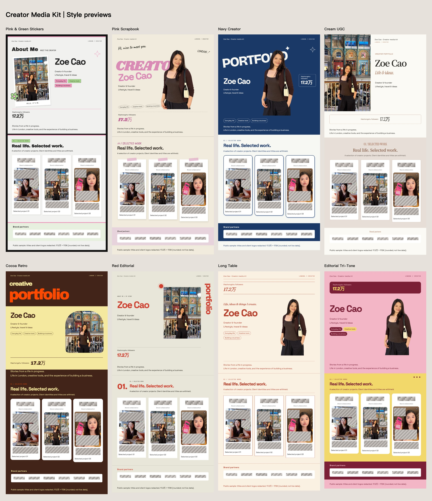

# Beyond the Feed

**Seen to Signed.** Turn your content into a portfolio worth sharing.

An AI skill for creators who need a clear, visual introduction to their work. Start with a screen recording, screenshots, or an accessible profile link. The assistant organizes the available evidence, recommends a visual direction, and builds a shareable media kit in PNG, JPG, and editable HTML.

Eight visual styles. Three recommended previews by default. No paid data API required for the recording or screenshot workflow.

## Why I built this

Many of my client conversations start on WeChat. Someone finds my content, gets in touch, and wants to understand what working together might look like. At that point, I need a practical way to introduce myself: what I create, who my content is for, and which pieces of work best represent me.

A personal website can hold all of that. But in the middle of a conversation, sending a website also asks someone to leave the chat, open another page, and decide where to look. When I reply by email, I face a similar question: how much can I make clear before asking the recipient for another click?

I wanted something that fits the way those conversations already happen. One image that opens directly in a chat or sits alongside an email. A concise overview that someone can scan, save, and forward to a colleague. Enough context to understand my work and decide whether to continue the conversation.

That is the idea behind Beyond the Feed. The examples in the style overview use my own photographs and selected work, so you can see the kind of introduction I wanted to be able to send. The public version keeps the person and the visual composition while withholding specific video titles and client identities.

The starting material already exists. It is on a creator's profile, in their published posts, and in the screenshots they keep collecting. The difficult part is choosing what matters, explaining it clearly, and putting it into a consistent visual format. I built this skill to help with that transition: from a collection of posts to an introduction someone can use to evaluate a potential collaboration.

**Visibility gets you noticed, Portfolio gets you hired.** To me, that line describes two different moments in the same journey. Content helps someone discover you. A portfolio helps them understand what you can bring to a project. This tool focuses on that second moment.

This project is part of the creator-focused tools I am building from my own working experience. Its starting point is a small, recurring task in a real creator workflow: sending the right introduction when an opportunity arrives.

## What it creates

The primary output is a vertical media kit designed to be shared as an image. It can include your positioning, platform statistics, selected work, confirmed brand collaborations, and business contact details.

| Deliverable | What it is for |
| --- | --- |
| PNG | A crisp image for direct sharing and review |
| JPG | An additional image format for messaging and email |
| Editable HTML and assets | A version you can revise without starting over |
| Style overview | A side-by-side comparison of the proposed directions |
| Private source brief | The structured material and source notes behind the output |

A preview contains the introduction, up to three pieces from the first selected group, and a compact strip of confirmed brand names or logos when available. A full output contains all supplied cases, including any that were not explicitly assigned to a section.

The assistant normally recommends three previews first, then produces the selected full version. You can also request one specific style or all eight complete versions immediately.

## Start with what you have

### Option 1: A short screen recording

This is the simplest starting point if your profile is already open on your phone or computer.

1. Show the top of your profile for about two to three seconds, with your name, bio, and follower count visible.
2. Scroll slowly through your posts, pausing briefly on each screen.
3. Open three to six representative posts. Pause on each so the title and relevant engagement numbers can be read.
4. Send the recording to your assistant. You do not need to narrate it or play each video in full.

A recording of roughly 30 to 90 seconds is often enough for an initial selection. Clear, stationary text matters more than a high frame rate. The assistant reviews key frames, returns to useful timestamps, and uses the visible evidence to prepare the brief. Video inspection requires suitable capabilities in the host assistant or an available local decoder.

```text
Use $creator-media-kit with this screen recording of my profile.
Create an English media kit for brand partnerships.
Recommend three visual directions and keep any unverified details out.
```

### Option 2: Screenshots and existing materials

A profile screenshot and three to six post screenshots are a useful starting set. Add an original portrait, confirmed client list, or business email if you want them included. Photos and contact details are optional.

Only have a profile screenshot? The assistant can start with an introduction preview and identify the few materials needed to expand it. You do not need to complete a long questionnaire before seeing a first draft.

```text
Use $creator-media-kit with these screenshots.
I create travel and lifestyle content. Build a concise portfolio for
potential brand partners, with an editorial visual style.
```

### Option 3: A profile link

The assistant can attempt to read an accessible profile through the host's web or browser tools. The documented profile-reading workflow focuses on Xiaohongshu, also known as RedNote. If a supported browser connection is already available, it can use the user's existing signed-in session.

A link does not guarantee complete access. A page may require login, show rounded follower counts, or hide clear covers. The assistant reports what it could actually read and uses recordings or screenshots to fill meaningful gaps. No TikHub integration or subscription is required by this repository.

```text
Use $creator-media-kit with this profile link: [paste your URL].
Read what is available and create three English preview directions.
If something important is inaccessible, tell me exactly what is missing.
```

## Install the skill

This repository is a skill package, not a hosted application. It needs an AI assistant that can read skill instructions, inspect your materials, and run the included build tools.

Download the repository and place its contents inside a folder named `creator-media-kit` in your assistant's supported skill directory. For a default local Codex setup, the resulting entry point is:

```text
~/.codex/skills/creator-media-kit/SKILL.md
```

If that destination does not already exist, you can install the complete package directly:

```sh
git clone https://github.com/zoe790/creator-media-kit.git ~/.codex/skills/creator-media-kit
```

If you already have a local version, preserve any customizations before updating it. You can also download the repository ZIP and extract it into your supported skill directory.

Keep the accompanying `references`, `assets`, `scripts`, and `agents` folders alongside it. The templates and bundled fonts are part of the skill, not optional downloads.

Invoke the skill by name and attach your material, using one of the prompts above. In another assistant, follow that host's skill-loading conventions and explicitly point it to `SKILL.md` when necessary. Host-specific installation and media capabilities may differ.

## Try the included demo

You can test the layout engine without connecting a social account or providing personal data. The default `assets/examples/brief.json` uses a clearly labelled fictional “Sample Creator” fixture. The real Zoe Cao showcase lives separately in `assets/examples/zoe-cao/`, with its own asset-use notice.

Requirements:

- Python 3 for HTML generation; the builder uses only the standard library.
- Node.js, Playwright, and a compatible Chromium browser for image export.
- Local fonts are included. Generated pages do not depend on remote font services.

From the repository root, build three previews into a new sibling directory:

```sh
python3 scripts/build.py \
  --input assets/examples/brief.json \
  --output ../media-kit-demo-v1 \
  --styles cream-ugc,red-editorial,long-table \
  --mode preview
```

If Playwright is not already available, install it in a separate tools directory:

```sh
npm install --prefix ../media-kit-render-tools playwright
../media-kit-render-tools/node_modules/.bin/playwright install chromium
```

Export the images using that installation:

```sh
PLAYWRIGHT_MODULE_PATH="$(cd ../media-kit-render-tools/node_modules/playwright && pwd)" \
  node scripts/render.cjs --input ../media-kit-demo-v1/manifest.json
```

These shell examples use macOS/Linux syntax. On other systems, set the equivalent environment variable in your shell. `PLAYWRIGHT_MODULE_PATH` accepts an absolute path to an existing Playwright module. `CHROME_PATH` can point to a compatible installed Chrome executable instead of Playwright's Chromium.

Open the output's `index.html` to compare the images and open individual layouts. To build all eight complete versions, use `--styles all --mode full` and a new output directory. The CLI defaults to `all` and `full`; the assistant explicitly chooses the three-style preview workflow.

To reproduce the redacted showcase locally, use `assets/examples/zoe-cao/brief.json` as the input with a new output directory. Its images are already flattened with opaque mosaic masks; no unredacted client logos or post screenshots are included. The source brief uses neutral project and client identifiers. Keep the [showcase asset notice](assets/examples/zoe-cao/LICENSE.txt) with these files, and replace them with your own authorized material for your portfolio.

## Eight visual directions



*This is my own media kit, presented as Zoe Cao. The portrait and work samples are real. Video titles, identifying screenshot text, and client logos are masked for public display. The follower figure is a recorded, rounded platform count, not a live metric or a campaign result. [Compare all eight styles](assets/examples/eight-styles-preview.jpg).*

| Style | Character | Style ID |
| --- | --- | --- |
| Pink & Green Stickers | Playful accents, paper texture, framed photography | `pink-sticker` |
| Pink Scrapbook | Oversized lettering and handwritten details | `pink-scrapbook` |
| Navy Creator | Strong blue-and-white contrast and bold statistics | `navy-creator` |
| Cream UGC | Warm neutrals, serif typography, quiet framing | `cream-ugc` |
| Cocoa Retro | Brown, orange, and butter-yellow with expressive type | `cocoa-retro` |
| Red Editorial | Restrained red accents and an editorial hierarchy | `red-editorial` |
| Long Table | Cream, brick red, fine rules, and structured information | `long-table` |
| Editorial Tri-Tone | Burgundy, pink, and yellow in a magazine-inspired layout | `editorial-tri-tone` |

Every style includes a layout without a portrait. A missing photo does not leave an empty frame or trigger the generation of a fictional person. The assistant can adjust the exported HTML and CSS for unusually long names, additional platforms, or dense screenshots.

## How it works

```text
Recording, screenshots, or an accessible profile
                    |
          Assistant reviews the evidence
                    |
          brief.json + private source notes
                    |
          Python builds local HTML layouts
                    |
          Playwright exports PNG and JPG
                    |
          Visual review and editable delivery
```

The assistant handles the judgment: understanding the materials, selecting representative work, suggesting positioning, and checking the result. The scripts handle repeatable layout construction and export.

`build.py` consumes a local `brief.json`; it does not accept a profile URL as a crawler command. The repository does not include a standalone video transcription service, a browser extension, or a universal social-platform scraper. The recording-to-brief step is an assistant workflow using the host's available media tools.

The input model records where important facts came from. A follower count can point to a screenshot; a case can point to a recording and timestamp; a confirmed brand can carry a separate confirmation source. Those records help with review, but they are not an automatic guarantee that every claim is correct.

## What makes a useful portfolio

A media kit should make a creator easier to understand. It should also be clear about what the evidence supports.

- **Keep statistics faithful.** Platform counts stay separate. Rounded values remain rounded; the tool does not infer unique reach or invent precise counts.
- **Separate work from endorsements.** A product appearing in a post does not establish a paid collaboration. Unknown relationships are labelled “Content showcase.”
- **Use only confirmed clients.** Brand strips contain confirmed relationships. Logos are sourced separately from official brand materials when available.
- **Preserve the source.** Original screenshots are not repainted, and figures inside them are not rewritten to make a stronger pitch.
- **Keep the creator in control.** Suggested positioning is editable copy. It does not create new qualifications, audience demographics, or campaign results.

English is the default language for documentation, template labels, and demonstration content. User-provided names and source images are preserved; the assistant can draft English explanatory copy around evidence in another language without altering that evidence.

## Scope, cost, and current limits

The recording and screenshot paths require no paid data API. Your assistant's own usage charges, if any, are separate. Profile access depends on the host's tools and the platform's current behavior; browser support is not a promise that every field can be retrieved.

The builder and renderer are implemented and tested. Recording intake has been tried on a real creator profile recording. Automated access through a signed-in browser connection has not been validated end to end in the current release workflow.

Original photos and post screenshots generally give the strongest image quality. If a recording only contains tiny or blurred covers, the assistant may produce a useful introduction first and request a small number of clearer images for the final version. Very long media kits may also benefit from supplementary sections for mobile reading.

Keep private briefs, recordings, and unredacted client materials outside this repository. The public package includes a creator-authorized, redacted Zoe Cao showcase and separate fictional testing fixtures. Display permission for this example does not authorize publishing another user’s material.

## Repository guide

```text
creator-media-kit/
  SKILL.md                 Instructions for the assistant
  README.md                Project story and user guide
  agents/openai.yaml       Skill discovery metadata
  scripts/build.py         Brief-to-HTML builder
  scripts/render.cjs       Image export and rendering checks
  scripts/test_build.py    Behavioral tests
  references/              Intake, schema, design, and delivery guidance
  assets/templates/        Eight HTML/CSS styles
  assets/examples/         Fictional fixtures and an authorized redacted showcase
  assets/fonts/            Bundled fonts
  assets/licenses/         Third-party license notices
  LICENSE                  MIT license for project code
```

See the [input schema](references/input-schema.md) to author a brief directly, [recording guide](references/screen-recording.md) for video intake, and [rendering guide](references/rendering.md) for export and review details.

## Development and verification

```sh
python3 scripts/test_build.py
```

Tests cover safe text output, preservation of unassigned cases, invalid references, preview limits, multiple platforms, confirmed-brand filtering, unknown relationship labels, and partial account data. The renderer checks for broken images, horizontal overflow, and page errors. Visual review is still necessary: passing those checks does not establish that every caption is readable on a phone.

Useful contributions include reproducible layout fixes, clearer intake instructions, and tests that protect meaningful behavior. Use fictional fixtures and include the relevant style ID, build command, and an image of the issue when reporting a layout problem. Do not attach private client materials.

## License and credits

Project scripts and templates are provided under the [MIT License](LICENSE). Fonts and referenced design resources retain their own licenses; see [Credits](references/credits.md). Photos, screenshots, and trademarks supplied by a user do not become MIT-licensed simply because the tool includes them in a media kit.
